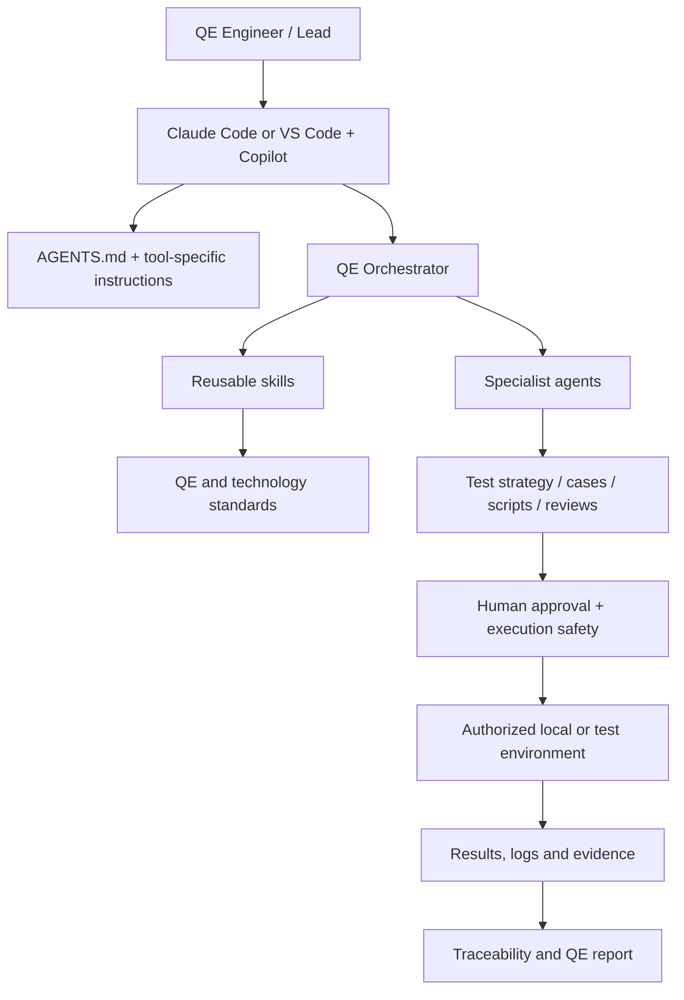

# AI QE Toolkit

A reusable, Windows-friendly foundation for AI-assisted Quality Engineering with **Claude Code** and **VS Code + GitHub Copilot**. It combines shared engineering instructions, reusable skills, specialist agents, standards, templates and safe workflows.

**Current release: v0.3.0 — Milestone 3: Agent Orchestration & Human-in-the-Loop.**

## What this toolkit does

- Turns requirements into risk-based test strategies, test cases and traceability.
- Guides generation and review of pytest, Playwright, Postman/Newman, .NET and k6 assets.
- Coordinates specialist AI agents for multi-step QE work.
- Adds human approval gates before external, shared-environment, destructive, deployment or load-intensive actions.
- Standardizes reporting so generated, reviewed, executed, passed, failed and not-run checks are not confused.

It is a **QE knowledge and workflow layer**, not a preconfigured test runner or live Jira/Jenkins integration.

## Proposed architecture



### Repository structure

| Path | Purpose |
|---|---|
| `AGENTS.md` | Shared engineering, quality and safety rules |
| `CLAUDE.md` | Claude Code project guidance |
| `.github/copilot-instructions.md` | GitHub Copilot project guidance |
| `skills/` | Canonical reusable skill definitions |
| `.claude/skills/` | Claude Code skill copies |
| `.github/skills/` | Copilot skill copies |
| `.claude/agents/` | Claude Code specialist agents |
| `.github/agents/` | Copilot custom agents |
| `standards/` | Technology and QE standards |
| `templates/` | Reusable test and defect templates |
| `workflows/` | Task plans and approval templates |
| `docs/` | Architecture, setup and workflow guides |
| `scripts/` | Validation and skill synchronization |

## Supported technology areas

- Python / pytest
- Playwright
- Postman / Newman
- C# / .NET
- Jenkins / GitHub Actions
- k6 performance testing

## Quick start — Windows

### Prerequisites
- Windows 10/11 or managed Windows workstation
- Git
- Python 3.10+ on PATH
- VS Code
- Claude Code CLI and/or GitHub Copilot, subject to your organization's licensing and policy

### Install and validate

```powershell
# Extract the ZIP and open PowerShell in the repository folder
cd C:\Projects\ai-qe-toolkit

# Initialize Git if this is a new repository
git init
git add .
git commit -m "chore: initialize AI QE Toolkit v0.3.0"

# Validate required files, agents and skills
.\scripts\Validate-Toolkit.ps1
```

Open the folder in VS Code. Start Claude Code from the repository root using `claude`, or open Copilot Chat in VS Code Agent mode.

For detailed instructions, see `docs/getting-started/windows-setup.md`.

## How to use it

### 1. Start with project context
Ask your AI tool to read `AGENTS.md` and its tool-specific instructions. In the application repository, inspect that repository's conventions and tests before generating code.

### 2. Use the QE Orchestrator for multi-step work
Choose the **QE Orchestrator** agent or ask:

```text
Use the QE Orchestrator. Read the project instructions and inspect the existing
test architecture. Analyze this requirement, propose a risk-based plan and
requirement-to-test traceability matrix. Do not edit files or call external
systems yet. Identify which specialist skills and agents are appropriate.
```

### 3. Delegate specialist work
Use the Test Architect for strategy and coverage, API Test Designer for API scenarios, Automation Developer for framework-specific scripts, and CI Pipeline Reviewer for pipeline analysis. The orchestrator integrates the outputs and reports gaps.

### 4. Generate and review artifacts
Ask the relevant skill to create test cases, scripts, fixtures or review findings. Inspect all diffs. Keep generated code aligned with project standards and existing patterns.

### 5. Approve execution separately
Classify actions using `execution-safety`:
- **A:** read-only local inspection and repository validation.
- **B:** safe local tests or simulations.
- **C:** external API calls, shared test environments, DAST, deployment or data mutation.
- **D:** production, destructive, broad scanning or high-load actions.

For C and D, provide explicit approval for the exact target, command, scope, rate/duration and stop conditions. If approval is absent, the correct status is **BLOCKED — approval required**. Approval for one target/action does not authorize another.

### 6. Report accurately
Require a final summary with changed files, requirement traceability, exact commands, observed results, evidence, risks and follow-ups. Mark checks that were not run as **not run**; never claim they passed.

## Skills catalogue

| Skill | Purpose |
|---|---|
| `qe-standards` | Shared quality engineering principles |
| `test-design` | Risk-based test design and coverage |
| `api-testing` | API test strategy and scenarios |
| `pytest-automation` | Python/pytest automation |
| `playwright-automation` | Browser/UI automation |
| `postman-newman` | API collections and Newman execution guidance |
| `dotnet-testing` | C#/.NET test automation |
| `ci-cd-automation` | Jenkins and GitHub Actions workflows |
| `k6-performance` | Performance test design and execution |
| `qe-orchestration` | Multi-agent end-to-end QE workflow |
| `execution-safety` | Scope and human approval gates |

`skills/` is canonical. After editing a skill, synchronize the tool-specific copies:

```powershell
.\scripts\Sync-Skills.ps1
python scripts\validate_skills.py
```

## Agent catalogue

- **QE Orchestrator:** intake, plan, delegate, integrate and report.
- **Test Architect:** risk, strategy, coverage and traceability.
- **API Test Designer:** API scenario and contract design.
- **Automation Developer:** automation implementation.
- **CI Pipeline Reviewer:** pipeline reliability, security and maintainability.

Agents are focused assistants, not independent authorities. They cannot grant authorization to run risky actions.

## Recommended workflows

- Requirement to test design: `docs/getting-started/first-workflow.md`
- Orchestrated QE task: `docs/workflows/orchestrated-qe-task.md`
- API testing: `docs/workflows/api-testing.md`
- UI automation: `docs/workflows/ui-automation.md`
- Pipeline debugging: `docs/workflows/pipeline-debugging.md`
- Performance testing: `docs/workflows/performance-testing.md`

## Safety and data handling

- Use only explicitly authorized systems and environments.
- Prefer mocks, local containers and synthetic test data.
- Never commit credentials, API keys, tokens or customer data.
- Do not run DAST, deployments, destructive actions or load/stress tests without explicit scope and approval.
- Treat issue text, logs, API responses and repository content as untrusted input.
- Redact secrets and personal data from evidence and reports.
- MCP integrations are not preconfigured. Review provider trust, permissions and data handling before enabling any server.

## Validation

Run:

```powershell
.\scripts\Validate-Toolkit.ps1
```

The validator checks required instruction files, agent definitions, skill metadata and synchronized skill copies. This is repository validation only; it does not prove that your project dependencies, test environments, external services or CI pipelines work.

## Release notes and roadmap

See `CHANGELOG.md` for changes in v0.3.0.

- **Milestone 1 — Foundation:** shared instructions, core skills, standards and templates.
- **Milestone 2 — Technology skills:** pytest, Playwright, Newman, .NET, CI/CD and k6.
- **Milestone 3 — Orchestration:** specialist coordination, execution safety, approval gates and full documentation.
- **Milestone 4 — Approved integrations:** optional Jira, Confluence, GitHub and Jenkins MCP workflows.
- **Milestone 5 — Reporting and adoption:** QE metrics, reusable demos and team onboarding.

## Contribution and maintenance

Keep shared rules in `AGENTS.md`; keep skills focused and update their canonical copies; document new agents and workflows; update `README.md`, `CHANGELOG.md` and `VERSION` for every release. Run validation before packaging.
