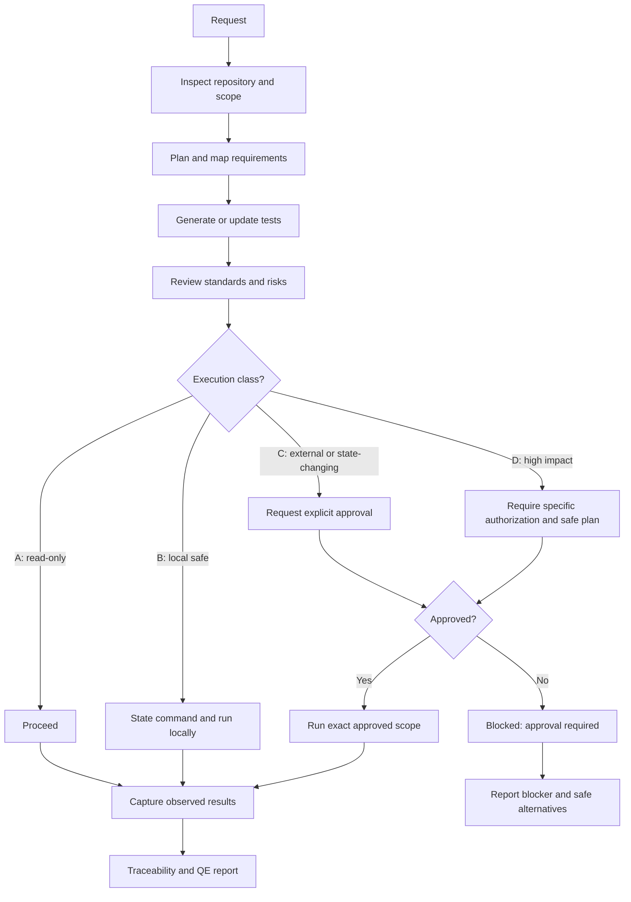

# Execution Flow and Approval Gates

## Execution classes
- **A:** read-only local inspection and repository validators.
- **B:** local tests/simulations without external access or shared-state mutation.
- **C:** API mutations, shared test environments, deployments, DAST, data changes.
- **D:** production, destructive, broad scanning or high-load activity.

See `execution-safety` skill for the complete approval checklist and safe defaults.
