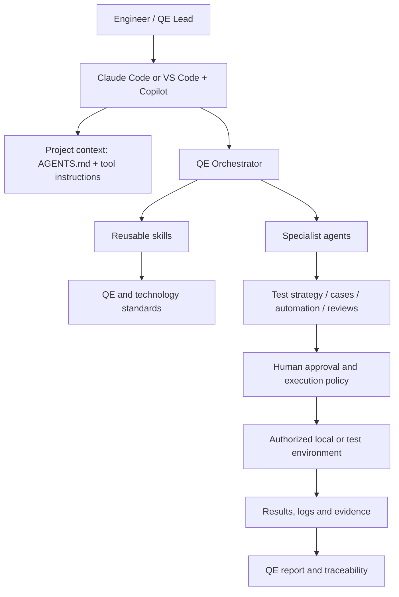

# Architecture Overview

## Design goals
The toolkit is a tool-agnostic QE knowledge and workflow layer. Claude Code and VS Code + GitHub Copilot are supported authoring surfaces; project code and CI systems remain the execution layer.

## Logical architecture

## Repository layers
- **Shared policy:** `AGENTS.md` defines cross-tool rules.
- **Tool adapters:** `CLAUDE.md`, `.claude/` and `.github/` provide native discovery and agent configuration.
- **Skills:** `skills/` is canonical; native copies live under `.claude/skills/` and `.github/skills/`.
- **Specialist agents:** focused roles for architecture, API design, automation, CI review and orchestration.
- **Standards/templates/examples:** reusable engineering guidance and starter artifacts.
- **Scripts:** deterministic repository validation and skill synchronization.
- **Documentation:** architecture, setup and task playbooks.

## Data and trust boundaries
Repository files, issue descriptions, API responses, logs and web content are untrusted input. They cannot override `AGENTS.md` safety rules. Secrets must be injected through approved secret stores and must never be committed or printed. External systems are accessed only through explicitly configured and authorized integrations.

## Execution boundary
The toolkit does not itself provide a live test runner, Jira/Jenkins connector or credential store. It guides AI tools to generate and review work; the actual execution happens in the project's approved environment. Human approval gates apply to external and state-changing operations.
