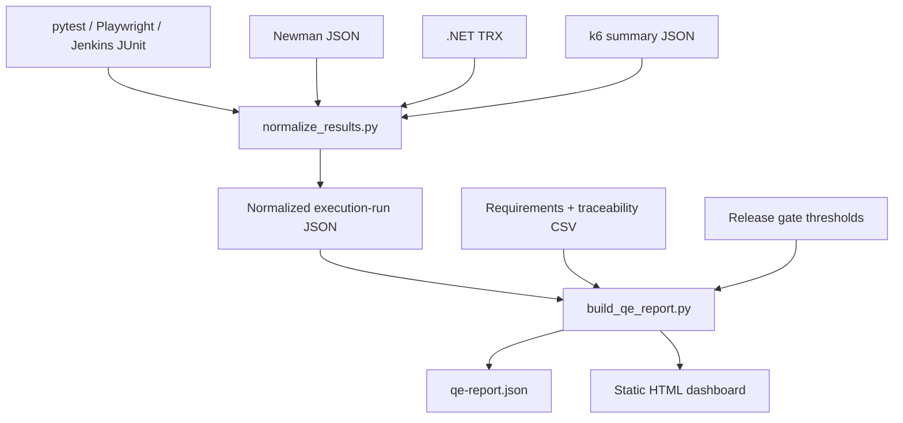

# QE Reporting Layer

Milestone 5 adds a lightweight, dependency-free reporting pipeline.

## Flow



## Quick demo

```powershell
python scripts/normalize_results.py --format junit --input examples/reporting/junit-sample.xml --output reports/normalized/junit.json
python scripts/normalize_results.py --format newman --input examples/reporting/newman-sample.json --output reports/normalized/newman.json
python scripts/normalize_results.py --format k6-summary --input examples/reporting/k6-summary-sample.json --output reports/normalized/k6.json

python scripts/build_qe_report.py `
  --runs reports/normalized/junit.json reports/normalized/newman.json reports/normalized/k6.json `
  --requirements examples/reporting/requirements.csv `
  --traceability examples/reporting/traceability.csv `
  --thresholds config/release-gates.example.json `
  --out-dir reports/latest
```

Open `reports/latest/index.html`.

## Supported result inputs
- JUnit XML: common pytest, Playwright and Jenkins JUnit publisher outputs.
- Newman JSON: request-level assertion outcomes.
- .NET TRX XML: common UnitTestResult records.
- k6 summary JSON: performance metrics, kept separate from test pass/fail counts.

## Tests
Run `python -m unittest discover -s tests -p "test_*.py"`.

## Important
The reporting pipeline is local and file-based. It does not fetch from Jenkins/GitHub APIs, start tests, infer flaky tests from one run, or make a release decision. Raw evidence should remain immutable and be stored separately.
